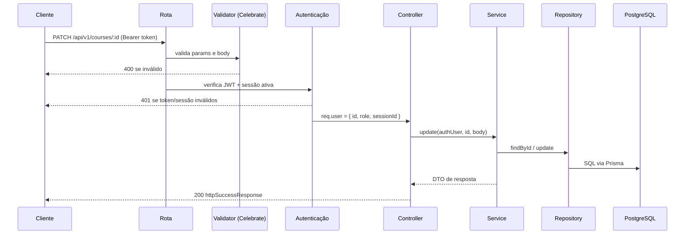
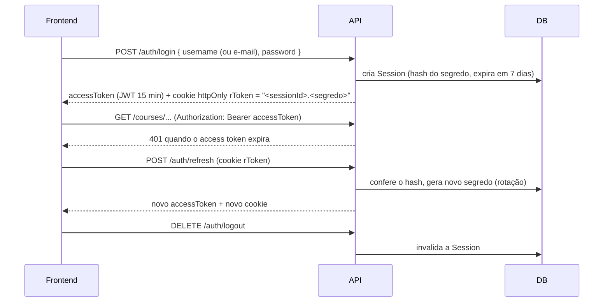
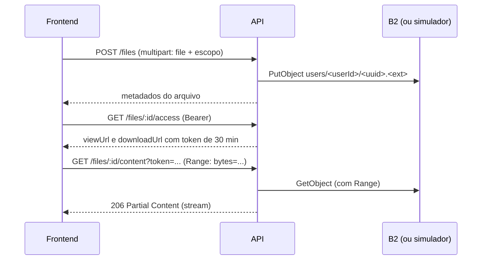

# Organizador de Estudos — Backend

API REST do sistema online para organização de estudos (TCC).
Node.js + TypeScript + Express 5 + Prisma (PostgreSQL) + Celebrate/Joi + JWT + Bcrypt + Jest.
Arquivos no Backblaze B2 (API compatível com S3), com um **simulador local** para rodar tudo sem armazenamento externo.

---

## 1. Rodando localmente, de ponta a ponta

Pré-requisitos: Node.js 20+ e Docker.

### 1.1 Subir o banco e o simulador do B2

```bash
docker compose up -d
```

O `docker-compose.yml` sobe dois containers:

| Serviço | Porta | O que é |
|---|---|---|
| `postgres` | 5432 | PostgreSQL 16 (usuário `admin`, senha `admin123`, bancos `tcc` e `tcc-test`) |
| `b2-local` | 9000 | Simulador do Backblaze B2 (`b2-local/server.mjs`) |

Se você já tem o seu próprio container do Postgres, suba só o simulador:

```bash
docker compose up -d b2-local
# ou, sem Docker:
npm run b2:local
```

### 1.2 Configurar e iniciar a API

```bash
npm install
cp .env.example .env              # já aponta para o Postgres e o B2 locais
cp .env.test.example .env.test    # banco usado pelos testes
npx prisma generate
npx prisma migrate deploy
npm run seed                      # cria o administrador: admin / Admin12345
npm run dev                       # http://localhost:3000/api/v1
```

Se o seu banco tiver outro nome/usuário, ajuste o `DATABASE_URL` no `.env`.

### 1.3 Endereços úteis

| Endereço | Uso |
|---|---|
| `http://localhost:3000/api/v1/health` | Saúde da API e do banco |
| `http://localhost:3000/api/v1/docs` | Documentação Swagger |
| `http://localhost:9000` | Painel do simulador do B2: lista os arquivos guardados |
| `http://localhost:5173` | Frontend (ver o README do frontend) |

### 1.4 Roteiro sugerido para a demonstração

1. Cadastre um aluno no frontend e crie um curso com módulos e disciplinas.
2. Inicie o cronômetro em uma disciplina, finalize e registre uma sessão manual.
3. Crie uma meta e veja o progresso no início e em **Estatísticas**.
4. Cadastre questões, monte uma atividade, responda e veja a correção.
5. Envie um PDF ou vídeo em **Arquivos** e abra a visualização (o arquivo aparece em `http://localhost:9000`).
6. Abra um chamado no **Suporte** com uma imagem.
7. Entre como `admin`, veja o painel, o acompanhamento do aluno e responda o chamado.
8. Em **Esqueci minha senha**, o link de redefinição aparece no console da API.

### 1.5 Comandos

| Comando | O que faz |
|---|---|
| `npm run dev` | API com recarga automática |
| `npm start` | API sem recarga |
| `npm test` | Testes (Jest) no banco do `.env.test` |
| `npm run typecheck` | Checagem de tipos |
| `npm run seed` | Cria/promove o administrador (`ADMIN_*` do `.env`) |
| `npm run b2:local` | Simulador do B2 sem Docker |
| `npx prisma migrate deploy` | Aplica as migrations |

---

## 2. Simulador local do Backblaze B2

O B2 é acessado pela API compatível com S3 (`@aws-sdk/client-s3`). O simulador `b2-local/server.mjs` implementa essa mesma API (criar bucket, enviar, baixar com `Range`, consultar e remover objetos), então **a API usa exatamente o mesmo código em desenvolvimento e em produção** — só as variáveis mudam:

| Variável | Simulador local | Backblaze B2 real |
|---|---|---|
| `B2_ENDPOINT` | `http://localhost:9000` | `https://s3.<região>.backblazeb2.com` |
| `B2_REGION` | `us-east-005` | região do bucket |
| `B2_BUCKET` | `organizador-estudos` | nome do bucket |
| `B2_KEY_ID` / `B2_APPLICATION_KEY` | `local-key-id` / qualquer valor | chaves de aplicação do B2 |
| `B2_FORCE_PATH_STYLE` | `true` | `false` |

O simulador confere apenas o `B2_KEY_ID` (não valida a assinatura) e grava os arquivos no volume `b2-data` (ou em `b2-local/data` quando roda com `npm run b2:local`).
Sem nenhuma variável `B2_*`, a API grava direto em disco, na pasta `STORAGE_LOCAL_DIR`.

---

## 3. Arquitetura

```
src/
├── app/          app.ts (express), server.ts, container-dependencies.ts (injeção de dependências)
├── config/       env.ts (variáveis de ambiente)
├── lib/          PrismaClient (driver pg)
├── middlewares/  validação, autenticação, autorização por perfil, upload, erros, 404
├── routes/       rotas centrais (/api/v1), health check e Swagger
├── modules/      um diretório por domínio
└── shared/       erros, DTOs comuns, hash, datas, escopo, armazenamento, e-mail, tokens de arquivo
```

Cada módulo segue a mesma divisão:

```
modules/<módulo>/
├── DTOs/          um DTO por arquivo
├── interfaces/    controllers/, repositories/, services/
├── controllers/   recebe a requisição e devolve a resposta
├── services/      regras de negócio
├── repositories/  acesso ao banco (Prisma)
├── routes/        rotas do módulo
└── validators/    schemas Celebrate/Joi (base-*.schema.ts + um arquivo por schema)
```

Todas as respostas têm o formato:

```json
{ "statusCode": 200, "state": "success", "data": [ ... ] }
{ "statusCode": 400, "state": "error",   "data": [ { "field": "title", "message": "..." } ] }
```

---

## 4. Fluxo de uma requisição



1. **`app.ts`** registra `cookie-parser` e `cors` (origens de `CORS_ORIGINS`, com credenciais).
2. **`routes/index`** monta tudo em `/api/v1` e ativa o parser de JSON.
3. Na rota do módulo, a ordem é: **validators** (`RequestValidator.paramsValidator/bodyValidator/queryValidator`) → **`authenticationMiddleware`** → **`requireRole("ADMIN")`** quando a rota é administrativa → **controller**.
4. O **controller** lê `req.user`, chama o service e responde com `httpSuccessResponse`.
5. O **service** aplica as regras: dono do recurso (`OwnershipService`), escopo (`ScopeService`), datas, limites. Operações com várias escritas usam `ITransaction`, que entrega os repositórios ligados a uma mesma transação do Prisma.
6. Qualquer erro vai para o **`ErrorHandler`**:

| Erro | Status |
|---|---|
| Celebrate (validação) | 400, com o campo de cada erro |
| `ValidationError` | 400 |
| `AuthorizationError` | 401 |
| `ForbiddenError` | 403 |
| `NotFoundError` / Prisma P2025 | 404 |
| Prisma P2002 (registro duplicado) | 400 |
| Upload acima do limite (Multer) | 400 |
| Outros | 500 (registrado no console) |

---

## 5. Autenticação e sessão



- **Login**: aceita nome de usuário ou e-mail. Gera a sessão e devolve o access token no corpo e o refresh token no cookie `rToken`.
- **Requisições autenticadas**: o middleware valida o JWT, busca a sessão (precisa estar válida, não expirada e com usuário ativo) e confere se o `sub` do token é o dono da sessão.
- **Refresh**: o segredo é trocado a cada uso. O segredo anterior continua aceito por 60 segundos, para não derrubar a sessão quando duas abas renovam juntas ou a resposta se perde.
- **Logout** invalida a sessão; **excluir a conta** ou **redefinir a senha** invalida todas as sessões do usuário.
- **Esqueci a senha**: `POST /auth/forgot-password` responde sempre a mesma mensagem (não revela se o e-mail existe). Se existir, gera um token de 30 min (`<id>.<segredo>`, só o hash fica no banco) e envia o link `FRONTEND_URL/reset-password?token=...` por SMTP — ou mostra no console quando não há `SMTP_HOST`. `POST /auth/reset-password` troca a senha e marca o token como usado.

### Perfis e acesso

| Regra | Onde |
|---|---|
| Usuário só acessa os próprios dados | `OwnershipService.validateOwnership` |
| ADMIN pode consultar/gerir dados de qualquer usuário (cursos, metas, sessões, questões, atividades) | `validateOwnership` e `resolveOwnerId` (aceita `userId` de outro usuário) |
| **Notas e arquivos são privados**: nem o ADMIN acessa | `validateStrictOwnership` |
| Rotas administrativas | `requireRole("ADMIN")` |

---

## 6. Fluxos por funcionalidade

### Cursos, módulos e disciplinas
- Hierarquia `Curso > Módulo > Disciplina`. Títulos são normalizados (maiúsculas, sem acento) e únicos dentro do pai.
- **Exclusão é lógica (`deletedAt`) e em cascata**: ao remover um curso, seus módulos e disciplinas são removidos, as metas e sessões de estudo ligadas são apagadas, questões e atividades do escopo recebem soft delete e notas/arquivos apenas perdem o vínculo (o conteúdo do aluno é mantido).

### Escopo
Metas, sessões, questões, atividades, notas e arquivos se ligam a **um** escopo: `courseId`, `moduleId` ou `disciplineId`. O `ScopeService` confere se o escopo existe e pertence ao usuário. Os filtros por escopo são hierárquicos: filtrar por um curso traz também o que está nos seus módulos e disciplinas.

### Sessões de estudo
1. `POST /study-sessions` inicia o cronômetro (só uma sessão em andamento por usuário).
2. `GET /study-sessions/active` devolve a sessão em andamento (o front mostra o tempo em todas as telas).
3. `PATCH /study-sessions/:id/finish` calcula os minutos a partir de `startedAt` e conclui.
4. `POST /study-sessions/manual` registra uma sessão já concluída (minutos + data, até 24 h).
O "dia" de cada sessão segue o fuso `APP_TIMEZONE` (padrão `America/Sao_Paulo`).

### Metas e estatísticas
- `GET /stats/goals` calcula o progresso de cada meta a partir das sessões concluídas no escopo e no período:
  - `DAILY_ONCE`: minutos no dia da meta.
  - `DAILY_RECURRING`: minutos de hoje e quantidade de dias em que a meta foi batida.
  - `TOTAL_BY_DATE` / `TOTAL_IN_PERIOD`: soma no período.
- `GET /stats/summary`: total, média por dia, sequência de dias, minutos por dia e distribuição por curso/módulo/disciplina (agrupa um nível abaixo do filtro).
- `GET /stats/performance`: notas das tentativas nas atividades ao longo do tempo e por atividade.

### Banco de questões e atividades avaliativas
1. **Questão**: múltipla escolha (2 a 6 alternativas) ou verdadeiro/falso (2 alternativas), sempre com exatamente uma correta.
2. **Atividade**: título + escopo + lista ordenada de questões. Só entram questões do mesmo dono e **dentro do escopo** da atividade (uma atividade de curso aceita questões do curso, dos seus módulos e disciplinas). A criação e a troca de questões rodam em transação.
3. **Responder**: `GET /activities/:id/answer` devolve as questões **sem o gabarito**; `POST /activities/:id/attempts` recebe as respostas, corrige no servidor e grava a tentativa (acertos, nota de 0 a 100, duração).
4. `GET /activities/attempts/:id` devolve a correção completa (alternativa marcada, correta e explicação).

### Bloco de notas
CRUD de notas com título, conteúdo e vínculo opcional a um escopo. Privadas ao dono.

### Arquivos (upload, download e streaming)



- Limite por arquivo: `MAX_FILE_SIZE_MB` (padrão 100 MB). Cota por usuário: 2 GB.
- `<video>`, `` e `<iframe>` não enviam o header `Authorization`, por isso a visualização usa links temporários assinados (`FILE_TOKEN_SECRET`).
- O suporte a `Range` permite avançar e voltar vídeos sem baixar o arquivo inteiro.

### Suporte (SAC)
1. O aluno abre um chamado (`POST /tickets`, multipart) com assunto, categoria, mensagem e até 5 imagens (PNG/JPG/GIF/WEBP, 5 MB cada).
2. O ADMIN lista todos os chamados (`GET /tickets`) e responde (`POST /tickets/:id/messages`).
3. Status: resposta do suporte → `ANSWERED`; nova mensagem do aluno → `OPEN`; o aluno pode encerrar (`CLOSED`) e o admin pode definir qualquer status. Chamado encerrado não recebe mensagens.
4. As imagens dos chamados ficam visíveis ao admin (foram enviadas ao suporte), também por links temporários.

### Painel administrativo
- `GET /admin/dashboard`: usuários (total, novos, ativos), minutos estudados por dia, conteúdos cadastrados, tentativas e chamados por status.
- `GET /admin/users/:id/overview`: resumo de um aluno (contagens, estudo, desempenho). De notas e arquivos aparecem apenas a quantidade e o volume.
- `GET /users` (paginado, com busca) e `PATCH /users/:id/role` para promover/rebaixar.

---

## 7. Rotas

A lista completa, com exemplos de corpo, está no Swagger (`/api/v1/docs`). Resumo:

| Módulo | Rotas (`/api/v1`) |
|---|---|
| auth | `POST /auth/login`, `POST /auth/refresh`, `DELETE /auth/logout`, `POST /auth/forgot-password`, `POST /auth/reset-password` |
| users | `POST /users`, `GET /users`, `GET /users/me`, `GET /users/id/:id`, `PATCH /users/:id`, `PATCH /users/:id/password`, `PATCH /users/:id/role`, `DELETE /users/:id` |
| courses / modules / disciplines | `GET /<recurso>/user/:userId`, `GET /<recurso>/id/:id`, `POST`, `PATCH /:id`, `DELETE /:id`, `GET /modules/course/:courseId`, `GET /disciplines/module/:moduleId` |
| goals | `GET /goals/user/:userId`, `GET /goals/id/:id`, `POST`, `PATCH /:id`, `DELETE /:id` |
| study-sessions | `POST /`, `POST /manual`, `GET /active`, `PATCH /:id/finish`, `GET /user/:userId`, `PATCH /:id`, `DELETE /:id` |
| stats | `GET /stats/summary`, `GET /stats/goals`, `GET /stats/performance` |
| questions / notes | `GET /<recurso>/user/:userId?courseId&moduleId&disciplineId&search`, `GET /id/:id`, `POST`, `PATCH /:id`, `DELETE /:id` |
| activities | CRUD + `PUT /:id/questions`, `GET /:id/answer`, `GET|POST /:id/attempts`, `GET /attempts/:id` |
| files | `POST /files`, `GET /files/user/:userId`, `GET /files/id/:id`, `GET /files/:id/access`, `GET /files/:id/content`, `PATCH /:id`, `DELETE /:id` |
| tickets | `GET /tickets`, `POST /tickets`, `GET /tickets/id/:id`, `POST /tickets/:id/messages`, `PATCH /tickets/:id/status`, `GET /tickets/attachments/:id/content` |
| admin | `GET /admin/dashboard`, `GET /admin/users/:id/overview` |

---

## 8. Testes

```bash
npm test
```

- Testes de **service** usam mocks (`jest.fn()`) dos repositórios e das dependências.
- Testes de **repository** rodam no banco real do `.env.test` (`tcc-test`); rode `npx dotenv -e .env.test -- npx prisma migrate deploy` antes da primeira vez.
- Fábricas de dados em `src/tests/factories`.

## 9. Observações sobre o Prisma

O Prisma usa `engineType = "client"` com o driver `@prisma/adapter-pg` (sem binário de query engine), por isso o `PrismaClient` é criado com `new PrismaPg(...)` em `src/lib/prisma.ts`. Depois de alterar o `schema.prisma`, rode `npx prisma migrate dev` e `npx prisma generate`.
